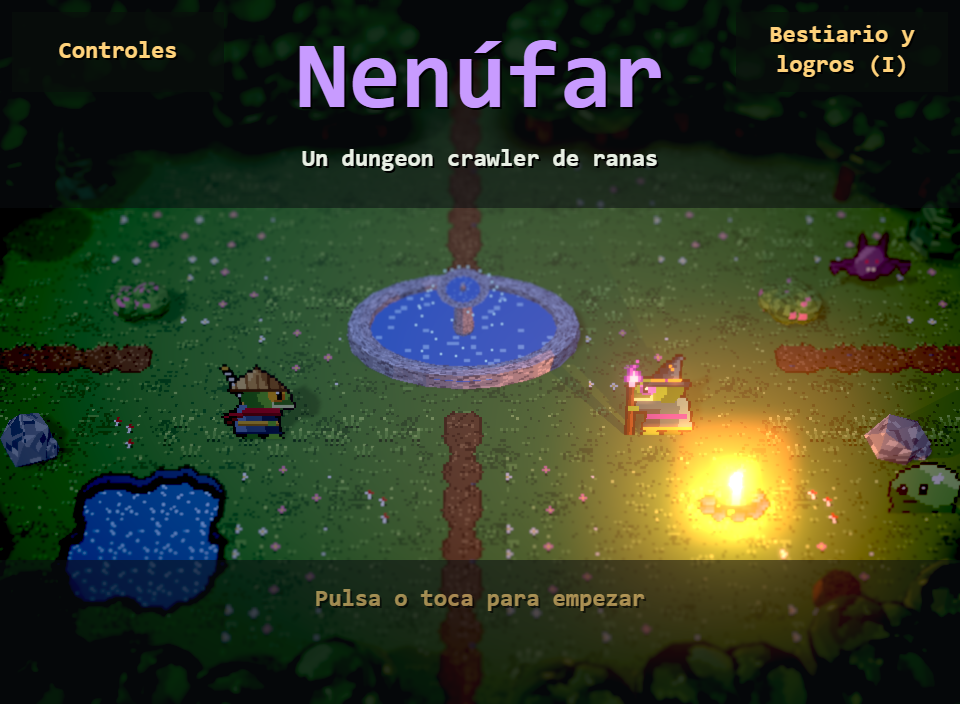
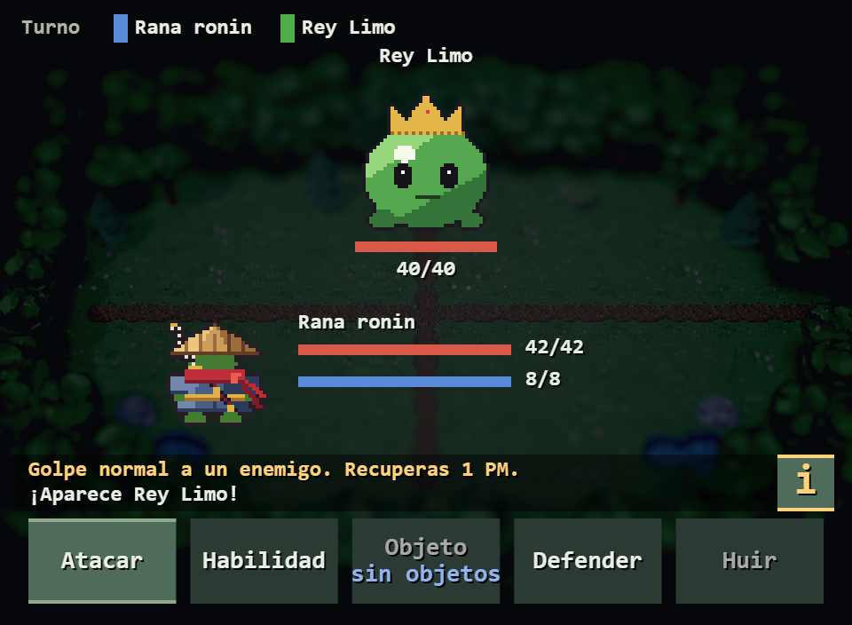
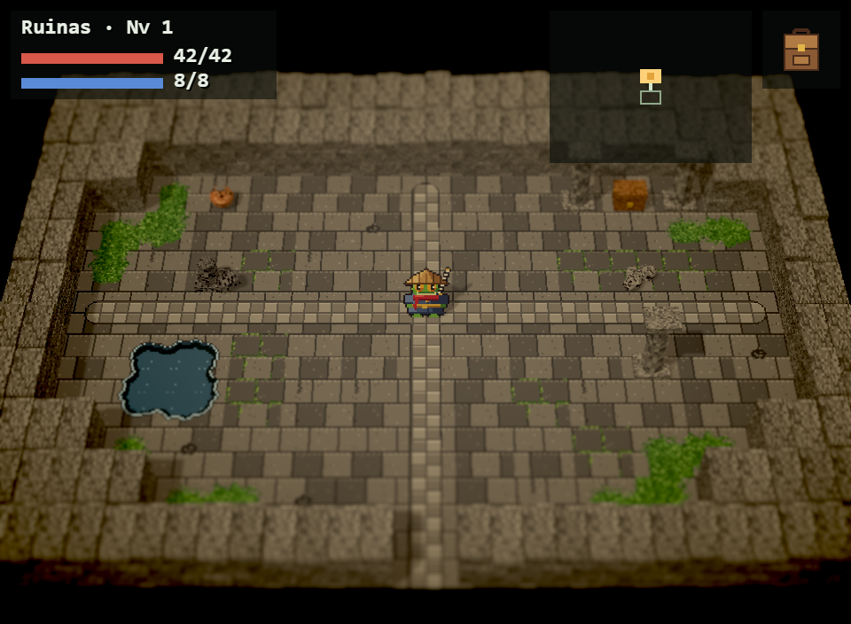
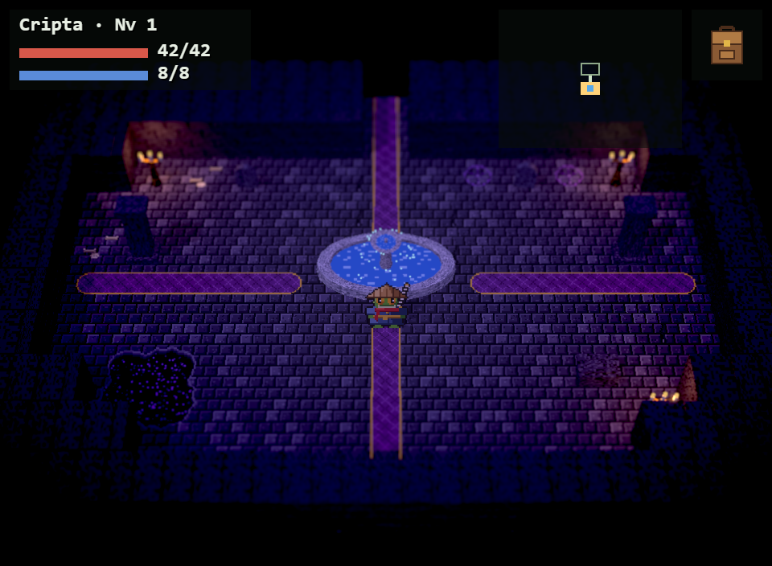
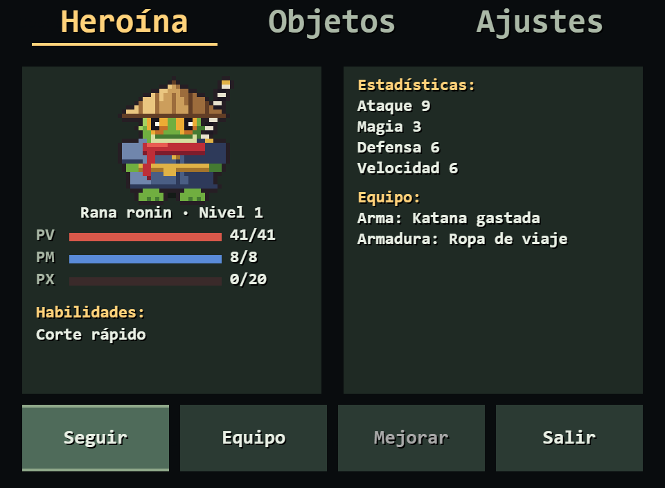
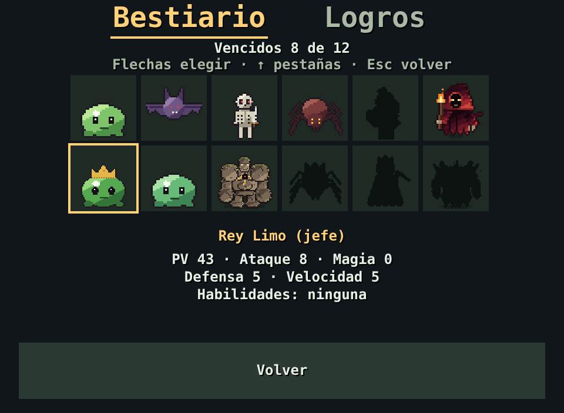

# Nenúfar

Dungeon crawler HD-2D para navegador y móvil (pixel art en escenarios 3D, al estilo de Octopath Traveler): exploras zonas de salas en tiempo real y, al tocar un monstruo, luchas en un combate por turnos estilo JRPG. Al empezar eliges heroína (una **rana ronin** de cuerpo a cuerpo o una **rana maga** de fuego morado), le pones nombre y eliges dificultad (Fácil, Normal o Difícil). Tres zonas (Bosque, Ruinas y Cripta), un jefe por zona y un jefe final, unidos por una historia corta: «El Eclipse de las Mil Charcas». Quien vence al jefe final ocupa su lugar: en la partida siguiente, el último jefe lleva tu nombre.



### ▶ [Jugar en el navegador](https://pedromiras.github.io/nenufar/)

| Explora el Bosque | Lucha | Enfréntate a los jefes |
| --- | --- | --- |
|  |  |  |
| **Las Ruinas** | **La Cripta** | **Elige heroína** |
|  |  |  |
| **Mejora a tu rana** | **Completa el bestiario** | |
|  |  | |

## Cómo se juega

| Acción | Teclado | Táctil |
| --- | --- | --- |
| Moverse y elegir | Flechas o WASD | Joystick (arrastra en cualquier punto) |
| Correr | Mantén Mayúsculas | Lleva el dedo al borde del joystick |
| Aceptar | Enter, Espacio o Z | Tocar la opción |
| Inventario (pausa) y volver | Escape o I (X también vuelve) | Botón de la mochila |
| Ayuda del combate (encendida al empezar) | I | Botón i (en Habilidad y Objeto, un toque elige y otro usa) |
| Bestiario y logros (en el título) | I | Botón de arriba a la derecha |
| Controles (en el título) | ← y Enter | Botón de arriba a la izquierda |

En el móvil se juega mejor en horizontal. En vertical el juego lo recomienda, y con «Jugar así igualmente» se estira a todo el ancho de la pantalla.

Cada zona se genera al entrar (`?semilla=N` en la URL repite una partida). Los monstruos patrullan y te persiguen; si los pillas por la espalda, atacas primero. En combate, fíjate en el golpe cargado que anuncian: es el momento de Defender. Cada nivel da puntos de mejora para repartir (vida, maná, ataque, magia, defensa, velocidad o daño crítico). Encuentra equipo en el botín y en los dos cofres de cada zona (lo que no te pones se guarda en la mochila y se cambia desde el Inventario), y bebe de la fuente una vez por zona; el minimapa marca los cofres, la fuente y al jefe. Algunas zonas esconden una **sala violeta** en un callejón, con un jefe opcional más duro que el de la zona y una recompensa especial; y a veces un cofre muerde. El inventario tiene tres pestañas: Heroína, Objetos y Ajustes (sonido, calidad gráfica, volumen de música y de efectos, y los controles); en calidad baja, para móviles modestos, el mapa va sin desenfoque ni sombras. Cada dificultad guarda sus récords; además hay seis logros y un bestiario que se completa venciendo a cada monstruo.

## Qué tiene de interesante por dentro

- **Sin motor:** TypeScript `strict`, bucle a 60 Hz fijos con dibujado interpolado. La interfaz y el combate, en Canvas 2D a mano, dibujado a la resolución real de la pantalla y con lo que se mueve colocado al píxel físico.
- **HD-2D con Three.js:** el mapa, la portada y el fondo del combate son escenas 3D en un canvas WebGL debajo del 2D. Los sprites van de pie, inclinados la mitad que la cámara; los muros, árboles y objetos son modelos sencillos con texturas pixeladas sacadas de los colores del propio arte; el agua y las fosas van hundidas en el suelo. Lo que queda entre la cámara y la heroína se vuelve transparente con un tramado en el shader. Tilt-shift, bloom, viñeta, sombras y luces que parpadean, todo con sus números en [src/data/hd2d.json](src/data/hd2d.json). La lógica no cambió al pasar a 3D: la Y en píxeles es la Z del mundo.
- **Lógica pura y testeada:** `src/core/` no toca el navegador. El combate es una máquina de estados que emite eventos y la escena solo los anima. Vitest cubre generación de zonas, combate, IA, jefes, objetos, progresión, récords y logros.
- **Datos, no números en el código:** estadísticas, habilidades, monstruos, zonas, botín, historia, logros, ritmo de las animaciones, música, efectos de sonido y el aspecto 3D de cada zona viven en `src/data/*.json`.
- **Equilibrado medido:** un test juega 300 partidas enteras con cada heroína en cada dificultad y exige que lleguen al final el 85-95 % en Fácil, el 65-75 % en Normal y el 45-55 % en Difícil, sin más de 5 puntos entre ellas ([tests/equilibrado.test.ts](tests/equilibrado.test.ts)); otro mide cada jefe violeta con cada heroína ([tests/violetas.test.ts](tests/violetas.test.ts)).
- **Todo el arte generado por script:** heroínas, monstruos, el efecto de cada habilidad y los tilesets salen de scripts deterministas en Python ([tools/generadores/](tools/generadores/)).
- **Sonido sintetizado:** música por zona y un sonido por habilidad con Web Audio a partir de notas en JSON; ningún archivo de audio.
- **Accesible:** se juega entero con teclado; lo que pasa en pantalla se lee en una región `aria-live` para lectores de pantalla; respeta `prefers-reduced-motion`.
- **Ligero:** unos 510 KB de descarga comprimida en total, Three.js incluido.

📄 **Documento de desarrollo:** https://claude.ai/code/artifact/a6ea0dd0-438d-4190-8647-06fd62dc8754

## Estado

- [x] Diseño de juego cerrado (ver documento)
- [x] Arte: heroínas, monstruos, efectos, tilesets de las tres zonas, objetos comunes, autotiles y plantillas de sala
- [x] Hito 1: base, sala y movimiento
- [x] Hito 2: zona generada
- [x] Hito 3: combate prototipo
- [x] Hito 4: contenido y progresión
- [x] Hito 5: objetos y pantallas
- [x] Hito 6: arte de combate y sonido
- [x] Hito 7: equilibrado, pulido y publicación
- [x] Versión 2: salas violetas (jefes opcionales, cofre trampa y recompensas especiales)
- [x] Hito 8: el mapa y la portada en 3D (HD-2D)
- [x] Hito 9: el combate con la sala 3D de fondo y el ajuste de calidad

## Desarrollo

```bash
npm install
npm run dev     # servidor de desarrollo
npm test        # tests (Vitest)
npm run lint    # ESLint y Prettier
npm run build   # tipos y build de producción en dist/
```

## Estructura

```text
nenufar/
├── src/
│   ├── core/       # lógica pura: zona, salas, movimiento, combate, IA, progresión, música
│   ├── data/       # JSON de diseño: héroes, monstruos, zonas, objetos, combate, historia, logros, ritmo, sonido, aspecto 3D, salas
│   ├── escenas/    # título, controles, selección, mapa, combate, inventario, equipo, puntos, bestiario y logros, historia (pila de escenas)
│   ├── input/      # teclado, joystick y toque como fuentes de acciones abstractas
│   └── render/     # canvas, sprites, HUD, sonido, accesibilidad y almacenamiento
│       └── mundo/  # el mapa en 3D con Three.js: bordes, modelos, agua, luces, transparencia y portada
├── public/assets/
│   ├── sprites/    # heroínas, monstruos, efectos y proyectil, cada hoja con su JSON
│   └── tilesets/   # bosque, ruinas, cripta, comunes y sus autotiles, con JSON
├── tests/          # Vitest, incluido el simulador de equilibrado
├── docs/           # capturas y vistas previas del arte
└── tools/generadores/  # scripts en Python que generan todo el arte
```

## Formato de los assets

**Sprites de personaje** (`rana_ronin.json`, `rana_maga.json`): cuadros de 32×32, una fila por dirección (`down`, `left`, `right`, `up`) y animaciones por columnas (`idle`, `walk`, `golpe`, `derrota` y el ataque: `atacar` en la ronin, `cast` en la maga). El ancla está en los pies, en (16, 30). En la maga, `castReleaseFrame` indica el fotograma en el que debe salir la bola de fuego.

**Monstruos** (`monstruos/<clave>.json`): el mismo formato, de 32×32 (48×48 los jefes grandes), con `idle`, `walk`, `atacar` y `golpe`; el ancla, en los pies. **Efectos y proyectil** (`efectos.json`, `fuego_morado.json`): también el mismo formato, con una sola fila para todas las direcciones; el fuego mira a la derecha.

**Tilesets** (`<zona>.json`): por cada tile, `name`, `index`, `layer` (`suelo`, `muro`, `objeto` o `dosel`), `solid`, `weight` en los suelos y `frames`/`fps` en los animados.
- Los objetos de dos tiles de alto se parten en `_sup` (dosel, no sólido) e `_inf` (sólido) y se ordenan por la Y de su base junto con los personajes.
- Las variantes `_a`, `_b`, `_c` se eligen al azar para evitar repeticiones.

**Autotiles** (`<zona>_autotiles.json`): 16 variantes por tipo según una máscara de vecinos `N=1, E=2, S=4, O=8`. Bosque: `camino` y `agua`. Ruinas: `calzada`, `charco` y `hierba`. Cripta: `alfombra` y `fosa`.

**Plantillas de sala** (`src/data/salas/plantillas_<zona>.json`): `tamano`, `leyenda` (símbolo → tile u objeto), `autotiles` (símbolo → tipo de autotile de la zona) y la lista de `plantillas`, cada una con `id`, `tipo` y `mapa` (11 líneas de 15 caracteres). Diseñar una sala nueva es añadir un mapa.

## Regenerar el arte

```bash
pip install -r tools/requirements.txt
python tools/generadores/generar_todo.py
```

Las semillas son fijas: sin cambios en los scripts, el resultado es idéntico píxel a píxel. Para cambiar colores o formas, edita las paletas al principio de cada script (`personajes/rana_ronin.py`, `entorno/bosque.py`…) y vuelve a ejecutarlo.

## Créditos

Ver [CREDITS.md](CREDITS.md).
