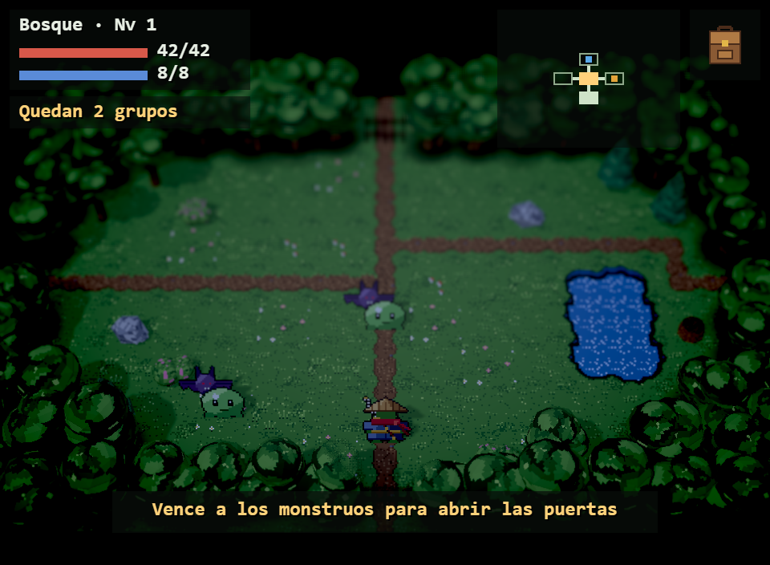
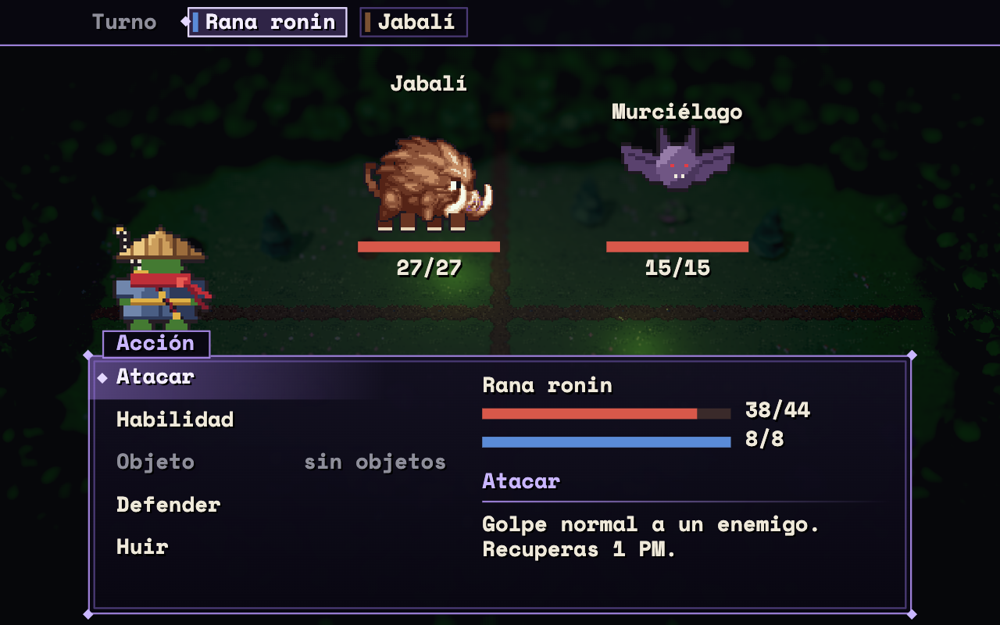
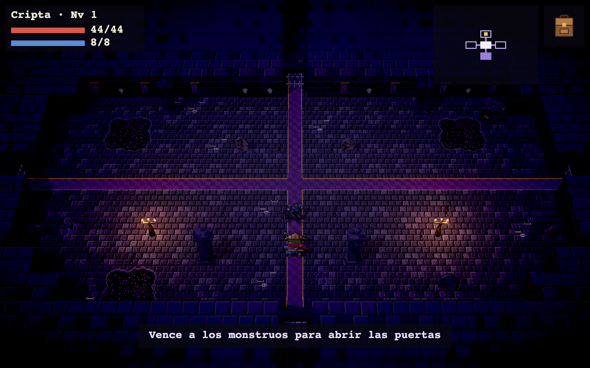
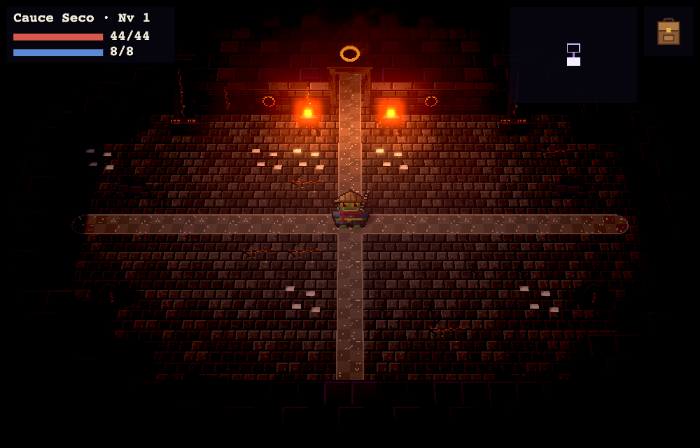
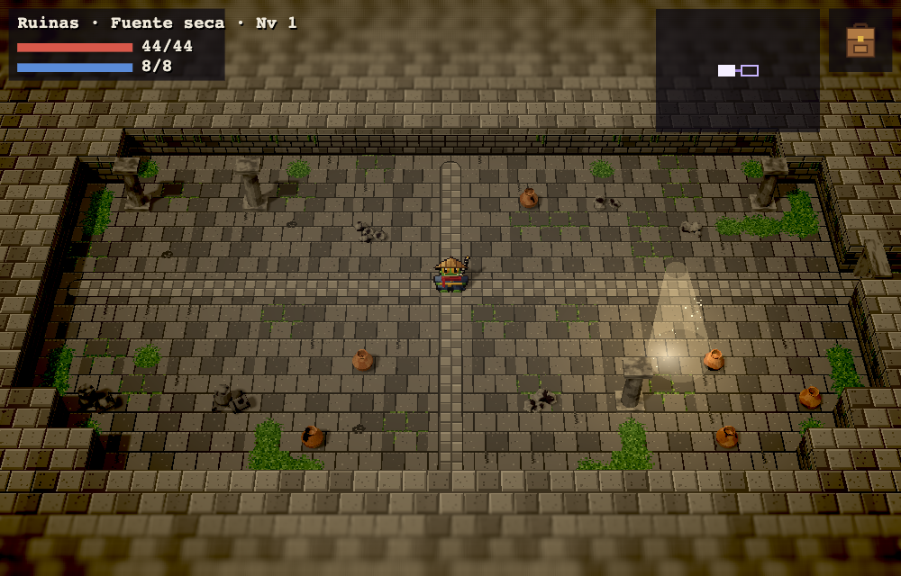
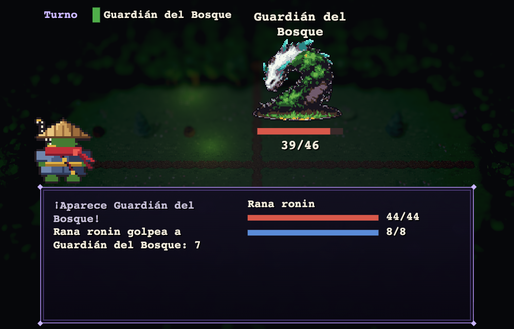
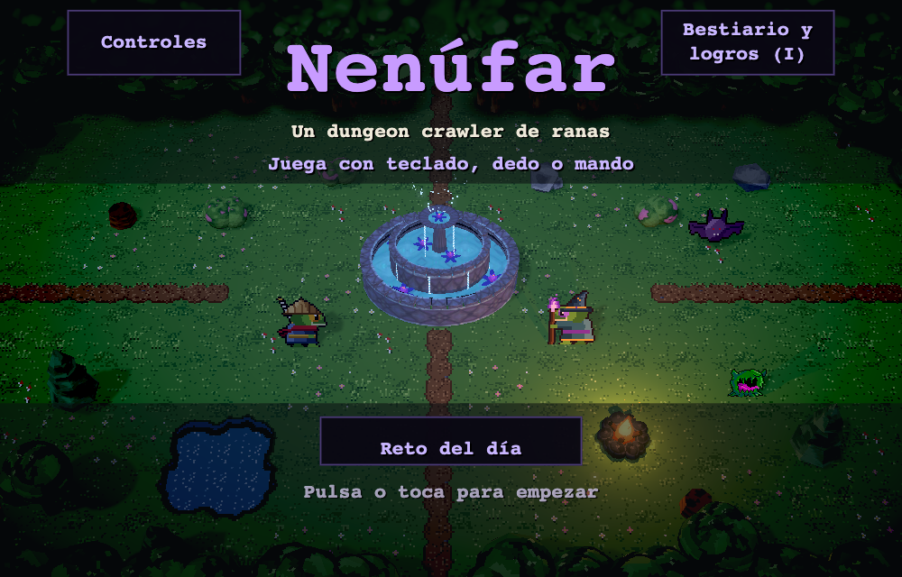
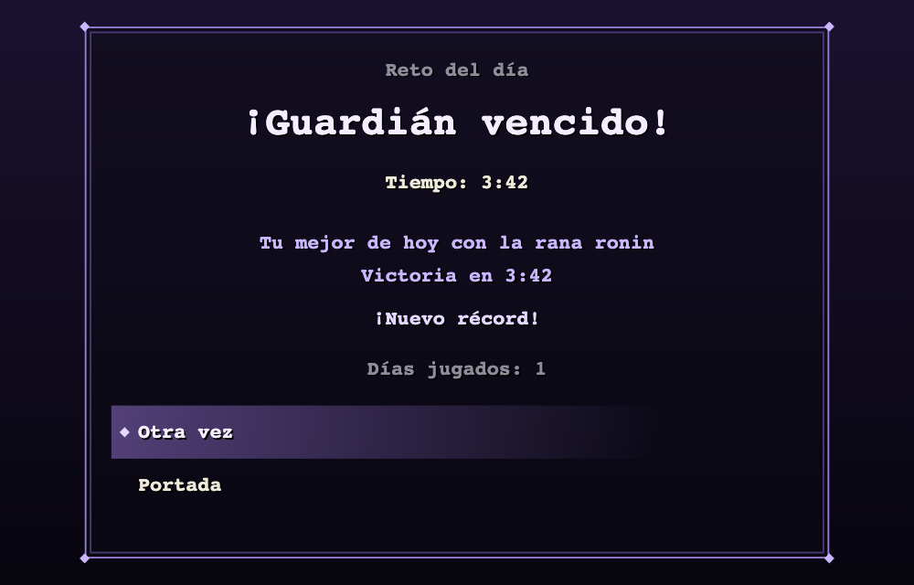
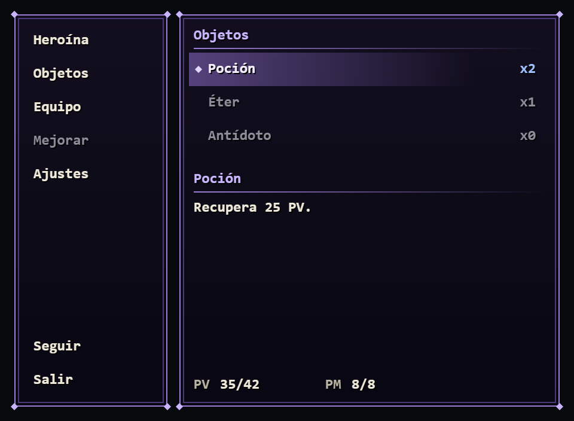

# Nenúfar

Dungeon crawler HD-2D para navegador y móvil (pixel art en escenarios 3D, al estilo de Octopath Traveler): exploras zonas de salas en tiempo real y, al tocar un monstruo, luchas en un combate por turnos estilo JRPG. Al empezar eliges heroína (una **rana ronin** de cuerpo a cuerpo o una **rana maga** de fuego morado), le pones nombre y eliges dificultad (Fácil, Normal o Difícil). Cuatro zonas (Bosque, Ruinas, Cripta y Cauce Seco), un jefe por zona y un jefe final, unidos por una historia corta: «El Eclipse de las Mil Charcas». Quien vence al jefe final ocupa su lugar: en la partida siguiente, el último jefe lleva tu nombre.

¿Poco tiempo? El **Reto del día** es una partida de unos cinco minutos con el mismo mapa para todo el mundo durante el día, y un récord por rana.

Se juega con teclado, con el dedo o con mando.


### ▶ [Jugar en el navegador](https://pedromiras.github.io/nenufar/)

| Explora el Bosque | Lucha | Enfréntate a los jefes |
| --- | --- | --- |
|  |  |  |
| **Las Ruinas** | **La Cripta** | **Elige heroína** |
|  |  |  |
| **El Cauce Seco** | **Luz de verdad** | **La cámara en el golpe** |
|  |  |  |
| **Reto del día** | **Tu récord de hoy** | |
|  |  | |
| **Mejora a tu rana** | **Completa el bestiario** | |
|  |  |  |

## Cómo se juega

| Acción | Teclado | Táctil | Mando (Xbox) |
| --- | --- | --- | --- |
| Moverse y elegir | Flechas o WASD | Joystick (arrastra en cualquier punto) | Stick o cruceta |
| Correr | Mantén Mayúsculas | Lleva el dedo al borde del joystick | X o gatillo derecho |
| Aceptar | Enter, Espacio o Z | Tocar la opción | A |
| Volver | Escape o X | La opción «Volver» de cada pantalla | B |
| Inventario (pausa) | Escape o I | Botón de la mochila | Menú |
| Usar una habilidad, un objeto o elegir enemigo | Enter (lo que hace se ve siempre a la derecha) | Dos toques: el primero elige y enseña qué hace, el segundo lo usa | A |
| Bestiario y logros (en el título) | I | Botón de arriba a la derecha | Y |

Los textos de ayuda cambian solos según lo último que hayas usado. El mando vibra con los golpes (se regula con el «Temblor» de Ajustes). En el móvil se juega en horizontal o en vertical: de pie, la cámara sigue a la heroína, el combate se apila en una columna y los menús van en pestañas.

Cada zona se genera al entrar (`?semilla=N` en la URL repite una partida) y a veces llega con un **presagio** que cambia sus reglas: luna roja, manada, fuente seca o coraza. Los monstruos patrullan, y un «¡!» avisa cuando te ven; si los pillas por la espalda, atacas primero. En combate, fíjate en el golpe cargado que anuncian: es el momento de Defender. Cada nivel da puntos de mejora para repartir (vida, maná, ataque, magia, defensa, velocidad o daño crítico). Encuentra equipo en el botín y en los dos cofres de cada zona (lo que no te pones se guarda en la mochila y se cambia desde el Inventario), y bebe de la fuente una vez por zona; el minimapa marca los cofres, la fuente y al jefe. Algunas zonas esconden una **sala violeta** en un callejón, con un jefe opcional más duro que el de la zona y una recompensa especial; y a veces un cofre muerde. Otros callejones guardan una **sala de evento**: un altar que pide vida o magia a cambio de algo, un desafío de tres combates seguidos sin recuperarte o un ermitaño que comparte sus provisiones. El inventario tiene pestañas de Heroína, Objetos, Equipo, Mejorar y Ajustes (sonido, calidad gráfica, volumen, temblor de la pantalla y los controles); en calidad baja, para móviles modestos, el mapa va sin desenfoque, sombras ni relieve. La partida se guarda al entrar en cada sala por si se cierra el navegador (sin trampas: un combate a medias se repite desde el principio). Cada dificultad guarda sus récords; además hay logros y un bestiario que se completa venciendo a cada monstruo.

## Qué tiene de interesante por dentro

- **Sin motor:** TypeScript `strict`, bucle a 60 Hz fijos con dibujado interpolado. La interfaz y el combate, en Canvas 2D a mano, dibujado a la resolución real de la pantalla y con lo que se mueve colocado al píxel físico.
- **HD-2D con Three.js:** el mapa, la portada y el fondo del combate son escenas 3D en un canvas WebGL debajo del 2D. Los sprites van de pie, inclinados la mitad que la cámara; los muros, árboles y objetos son modelos sencillos con texturas pixeladas sacadas de los colores del propio arte; el agua y las fosas van hundidas en el suelo. Lo que queda entre la cámara y la heroína se vuelve transparente con un tramado en el shader. Tilt-shift, bloom, viñeta, niebla, sombras y luces que parpadean, todo con sus números en [src/data/hd2d.json](src/data/hd2d.json). La lógica no cambió al pasar a 3D: la Y en píxeles es la Z del mundo.
- **Pixel art que recibe luz:** de cada hoja de sprite se saca un mapa de normales (un abombado desde el borde de la silueta más el brillo de cada píxel), así que la hoguera recorta a las ranas y a los monstruos como un contraluz ([src/core/relieve.ts](src/core/relieve.ts)). Las salas sin luces propias reciben luciérnagas, un haz de luz, un fuego fatuo o una grieta de brasa según la zona.
- **Golpes con peso:** cada golpe tiene un peso (leve, fuerte, máximo) con temblor de la escena, pausa de impacto, destello, número más grande y vibración del mando; la cámara del combate se acerca al atacante, más en críticos y contra jefes.
- **Lógica pura y testeada:** `src/core/` no toca el navegador. El combate es una máquina de estados que emite eventos y la escena solo los anima. Unos 650 tests de Vitest cubren generación de zonas, combate, IA, jefes, objetos, progresión, guardado, presagios, eventos, el reto del día, el mando, récords y logros.
- **Datos, no números en el código:** estadísticas, habilidades, monstruos, zonas, botín, historia, logros, ritmo de las animaciones, música, efectos de sonido y el aspecto 3D de cada zona viven en `src/data/*.json`.
- **Equilibrado medido:** una jugadora simulada ([src/core/jugadora.ts](src/core/jugadora.ts)) juega 300 partidas enteras con cada heroína en cada dificultad y el test exige que lleguen al final el 65-75 % en Fácil, el 45-55 % en Normal y el 25-35 % en Difícil, sin más de 5 puntos entre ellas ([tests/equilibrado.test.ts](tests/equilibrado.test.ts)); otros miden los jefes violetas, los presagios y las salas de evento.
- **Un reto del día justo para todos:** el mapa sale de la fecha, y antes de jugarlo el propio juego lo prueba 100 veces con cada rana con esa jugadora simulada; si alguna gana menos del 55 % o más del 75 %, pasa a la semilla siguiente (unos 60 ms, y el mismo resultado en todos los navegadores).
- **Arte generado por script:** heroínas, efectos y tilesets salen de scripts deterministas en Python ([tools/generadores/](tools/generadores/)); casi todos los monstruos se sacan, a doble resolución y con más fotogramas, de ilustraciones de referencia reducidas y repintadas con la paleta del juego.
- **Sonido sintetizado:** música por zona y un sonido por habilidad con Web Audio a partir de notas en JSON; ningún archivo de audio.
- **Accesible:** se juega entero con teclado o mando; lo que pasa en pantalla se lee en una región `aria-live` para lectores de pantalla; respeta `prefers-reduced-motion` (sin temblor ni fundidos).
- **Ligero:** unos 220 KB de código comprimido, Three.js incluido; con todo el arte, unos 3,5 MB.

📄 **Documento de desarrollo:** https://claude.ai/code/artifact/a6ea0dd0-438d-4190-8647-06fd62dc8754

## Estado

- [x] Diseño de juego cerrado (ver documento)
- [x] Arte: heroínas, monstruos, efectos, tilesets de las tres zonas, objetos comunes, autotiles y plantillas de sala
- [x] Hito 1: base, sala y movimiento
- [x] Hito 2: zona generada
- [x] Hito 3: combate prototipo
- [x] Hito 4: contenido y progresión
- [x] Hito 5: objetos y pantallas
- [x] Hito 6: arte de combate y sonido
- [x] Hito 7: equilibrado, pulido y publicación
- [x] Versión 2: salas violetas (jefes opcionales, cofre trampa y recompensas especiales)
- [x] Hito 8: el mapa y la portada en 3D (HD-2D)
- [x] Hito 9: el combate con la sala 3D de fondo y el ajuste de calidad
- [x] Guardado de la partida y menús nuevos
- [x] Cuarta zona: el Cauce Seco, con monstruos, jefe, jefe violeta y equipo de nivel 4
- [x] Móvil en vertical: mapa, combate y menús
- [x] Variedad entre partidas: presagios, salas de evento (altar, desafío y ermitaño) y plantillas nuevas
- [x] Monstruos a doble resolución
- [x] Peso de los golpes, mapa vivo y mando de Xbox
- [x] Reto del día
- [x] Luz y relieve: el pixel art recibe luz, fuentes de luz en todas las salas y cámara del combate

## Desarrollo

```bash
npm install
npm run dev     # servidor de desarrollo
npm test        # tests (Vitest)
npm run lint    # ESLint y Prettier
npm run build   # tipos y build de producción en dist/
```

## Estructura

```text
nenufar/
├── src/
│   ├── core/       # lógica pura: zona, salas, movimiento, combate, IA, progresión, guardado, eventos, reto, jugadora simulada
│   ├── data/       # JSON de diseño: héroes, monstruos, zonas, objetos, combate, historia, logros, ritmo, sonido, aspecto 3D, salas
│   ├── escenas/    # título, controles, selección, mapa, combate, inventario, equipo, puntos, eventos, reto, bestiario y logros (pila de escenas)
│   ├── input/      # teclado, joystick, toque y mando como fuentes de acciones abstractas
│   └── render/     # canvas, sprites, HUD, sonido, accesibilidad y almacenamiento
│       └── mundo/  # el mapa en 3D con Three.js: bordes, modelos, agua, luces, ambiente, relieve, transparencia y portada
├── public/assets/
│   ├── sprites/    # heroínas, monstruos, efectos y proyectil, cada hoja con su JSON
│   └── tilesets/   # bosque, ruinas, cripta, cauce, comunes y sus autotiles, con JSON
├── tests/          # Vitest, incluido el simulador de equilibrado
├── docs/           # capturas, vistas previas, diseños y planes de cada hito, y el vídeo de demo
└── tools/generadores/  # scripts en Python que generan todo el arte
```

## Formato de los assets

**Sprites de personaje** (`rana_ronin.json`, `rana_maga.json`): cuadros de 32×32, una fila por dirección (`down`, `left`, `right`, `up`) y animaciones por columnas (`idle`, `walk`, `golpe`, `derrota` y el ataque: `atacar` en la ronin, `cast` en la maga). El ancla está en los pies, en (16, 30). En la maga, `castReleaseFrame` indica el fotograma en el que debe salir la bola de fuego.

**Monstruos** (`monstruos/<clave>.json`): el mismo formato, con `idle`, `walk`, `atacar` y `golpe` y el ancla en los pies. Los que van a doble resolución llevan `scale: 2` (píxeles de hoja por píxel de juego) y se ven del mismo tamaño que el resto. **Efectos y proyectil** (`efectos.json`, `fuego_morado.json`): también el mismo formato, con una sola fila para todas las direcciones; el fuego mira a la derecha.

**Tilesets** (`<zona>.json`): por cada tile, `name`, `index`, `layer` (`suelo`, `muro`, `objeto` o `dosel`), `solid`, `weight` en los suelos y `frames`/`fps` en los animados.
- Los objetos de dos tiles de alto se parten en `_sup` (dosel, no sólido) e `_inf` (sólido) y se ordenan por la Y de su base junto con los personajes.
- Las variantes `_a`, `_b`, `_c` se eligen al azar para evitar repeticiones.

**Autotiles** (`<zona>_autotiles.json`): 16 variantes por tipo según una máscara de vecinos `N=1, E=2, S=4, O=8`. Bosque: `camino` y `agua`. Ruinas: `calzada`, `charco` y `hierba`. Cripta: `alfombra` y `fosa`. Cauce Seco: `lecho` y `lava`.

**Plantillas de sala** (`src/data/salas/plantillas_<zona>.json`): `tamano`, `leyenda` (símbolo → tile u objeto), `autotiles` (símbolo → tipo de autotile de la zona) y la lista de `plantillas`, cada una con `id`, `tipo` y `mapa` (13 líneas de 21 caracteres). Diseñar una sala nueva es añadir un mapa.

## Regenerar el arte

```bash
pip install -r tools/requirements.txt
python tools/generadores/generar_todo.py
```

Las semillas son fijas: sin cambios en los scripts, el resultado es idéntico píxel a píxel. Para cambiar colores o formas, edita las paletas al principio de cada script (`personajes/rana_ronin.py`, `entorno/bosque.py`…) y vuelve a ejecutarlo.

## Créditos

Ver [CREDITS.md](CREDITS.md).
