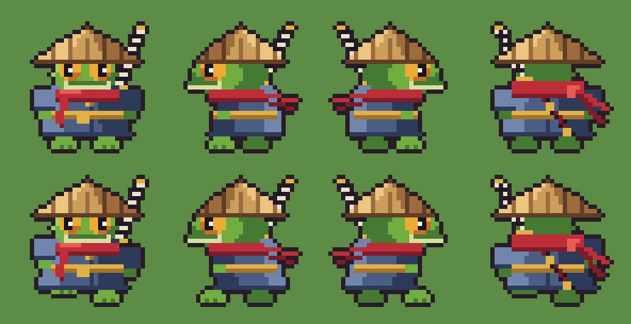
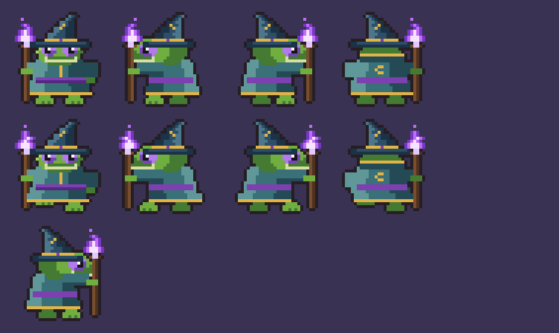
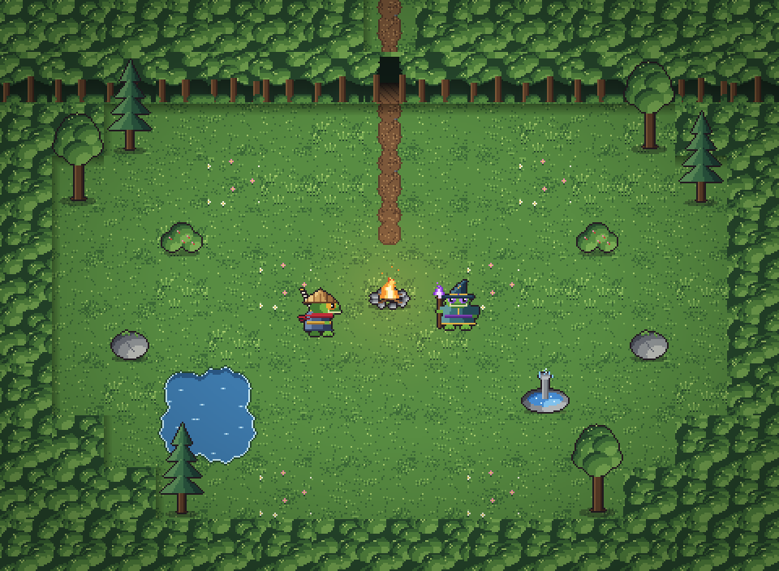

# Nenúfar

Dungeon crawler 2D para navegador: exploras zonas de salas en tiempo real y, al tocar un monstruo, luchas en un combate por turnos estilo JRPG. Al empezar eliges heroína: una **rana ronin** de cuerpo a cuerpo o una **rana maga** de fuego morado. Tres zonas (Bosque, Ruinas y Cripta), un jefe por zona y un jefe final.

**Stack:** TypeScript + Canvas 2D (sin motor) + Vite · Tests con Vitest · Despliegue en GitHub Pages.

📄 **Documento de desarrollo:** https://claude.ai/code/artifact/a6ea0dd0-438d-4190-8647-06fd62dc8754
(desde el propio documento se puede descargar en Markdown o PDF para guardarlo en `docs/`).

| Ronin | Maga |
| --- | --- |
|  |  |



## Estado

- [x] Diseño de juego cerrado (ver documento)
- [x] Arte: heroínas, proyectil, tilesets de las tres zonas, objetos comunes, autotiles y plantillas de sala
- [x] Hito 1: base, sala y movimiento ([jugar](https://pedromiras.github.io/nenufar/))
- [ ] Hito 2: zona generada
- [ ] Hito 3: combate prototipo
- [ ] Hito 4: contenido y progresión
- [ ] Hito 5: objetos y pantallas
- [ ] Hito 6: arte de combate y sonido
- [ ] Hito 7: equilibrado, pulido y publicación

## Estructura

```
nenufar/
├── public/assets/
│   ├── sprites/      # heroínas (32x32) y proyectil (16x16), cada hoja con su JSON
│   └── tilesets/     # bosque, ruinas, cripta, comunes y sus autotiles, con JSON
├── src/data/salas/   # plantillas de sala por zona (mapas ASCII de 15x11)
├── docs/previews/    # vistas previas del arte
└── tools/
    ├── requirements.txt
    └── generadores/  # scripts en Python que generan todo el arte
```

El código del juego (`src/engine`, `src/core`, `src/scenes`…) se añade a partir del hito 1 siguiendo la estructura del documento.

## Formato de los assets

**Sprites de personaje** (`rana_ronin.json`, `rana_maga.json`): cuadros de 32×32, una fila por dirección (`down`, `left`, `right`, `up`) y animaciones por columnas (`idle`, `walk` y, en la maga, `cast`). El ancla está en los pies, en (16, 30). En la maga, `castReleaseFrame` indica el fotograma en el que debe salir la bola de fuego.

**Tilesets** (`<zona>.json`): por cada tile, `name`, `index`, `layer` (`suelo`, `muro`, `objeto` o `dosel`), `solid`, `weight` en los suelos y `frames`/`fps` en los animados.
- Los objetos de dos tiles de alto se parten en `_sup` (dosel, no sólido) e `_inf` (sólido) y se ordenan por la Y de su base junto con los personajes.
- Las variantes `_a`, `_b`, `_c` se eligen al azar para evitar repeticiones.

**Autotiles** (`<zona>_autotiles.json`): 16 variantes por tipo según una máscara de vecinos `N=1, E=2, S=4, O=8`. Bosque: `camino` y `agua`. Ruinas: `calzada`, `charco` y `hierba`. Cripta: `alfombra` y `fosa`.

**Plantillas de sala** (`src/data/salas/plantillas_<zona>.json`): `tamano`, `leyenda` (símbolo → tile u objeto), `autotiles` (símbolo → tipo de autotile de la zona) y la lista de `plantillas`, cada una con `id`, `tipo` y `mapa` (11 líneas de 15 caracteres). Diseñar una sala nueva es añadir un mapa.

## Regenerar el arte

```bash
pip install -r tools/requirements.txt
python tools/generadores/generar_todo.py
```

Las semillas son fijas: sin cambios en los scripts, el resultado es idéntico píxel a píxel. Para cambiar colores o formas, edita las paletas al principio de cada script (`personajes/rana_ronin.py`, `entorno/bosque.py`…) y vuelve a ejecutarlo.

## Créditos

Ver [CREDITS.md](CREDITS.md).
