# Nenúfar

**Un dungeon crawler de ranas para el navegador y el móvil.** Pixel art sobre escenarios 3D (al estilo HD-2D de Octopath Traveler), exploración en tiempo real y combates por turnos estilo JRPG. Hecho en TypeScript, sin motor de juego.

**[▶ Jugar en el navegador](https://pedromiras.github.io/nenufar/)**

Se juega con teclado, con el dedo o con mando, en horizontal o en vertical. Si tienes poco tiempo, el **Reto del día** es una partida corta, pensada para unos cinco minutos.

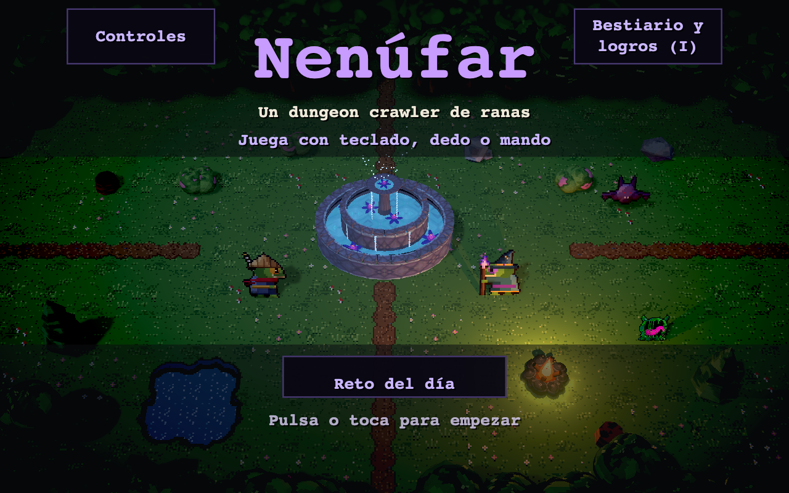

## El juego

Hace mil años, la luna se apagó y el Rey sin Charca se bebió el agua del mundo. Esta noche vuelve a apagarse. Eliges heroína, una **rana ronin** de cuerpo a cuerpo o una **rana maga** de fuego morado, y cruzas cuatro zonas hasta él: el Bosque, las Ruinas, la Cripta y el Cauce Seco. Cada zona se genera al entrar, tiene su jefe y a veces llega con un presagio que cambia sus reglas. Quien vence al jefe final ocupa su lugar: en la partida siguiente, el último jefe lleva tu nombre.

| El Bosque | Las Ruinas |
| --- | --- |
| 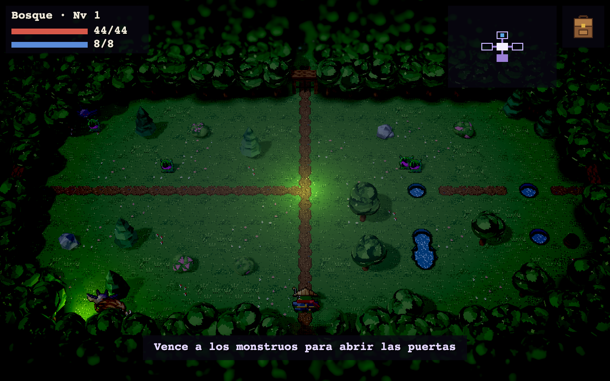 | 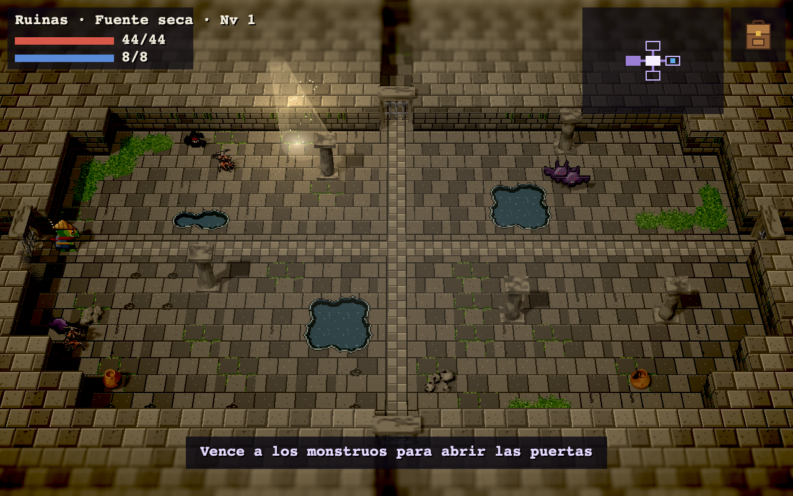 |
| **La Cripta** | **El Cauce Seco** |
|  | 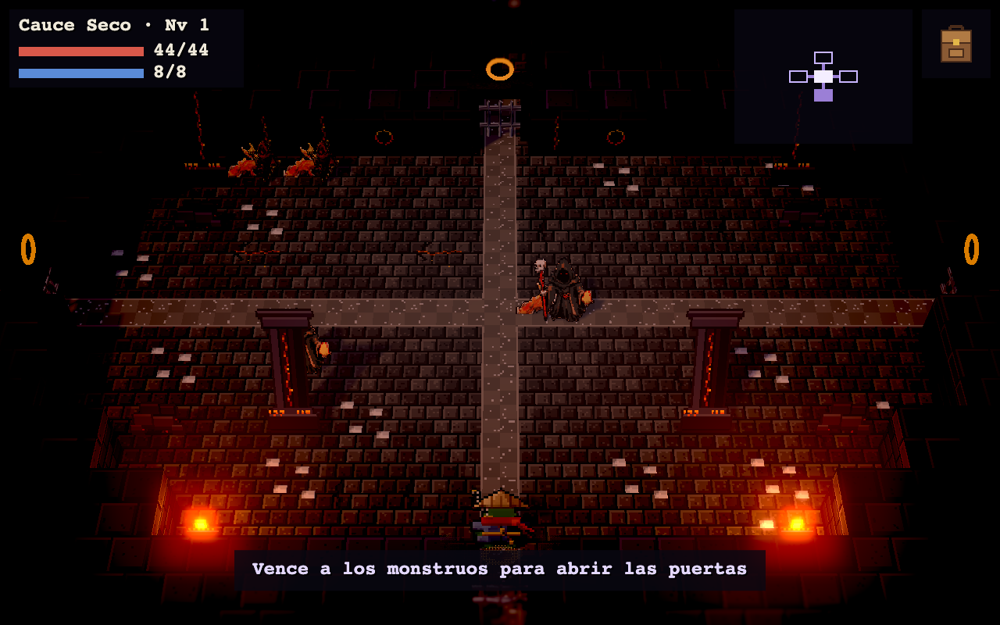 |

Al tocar un monstruo empieza el combate, con la sala de fondo. Cada acción dice lo que hace antes de elegirla, y los monstruos anuncian su golpe cargado un turno antes: es el momento de Defender.

| Combate | Jefe de la Cripta | Jefe final |
| --- | --- | --- |
|  | 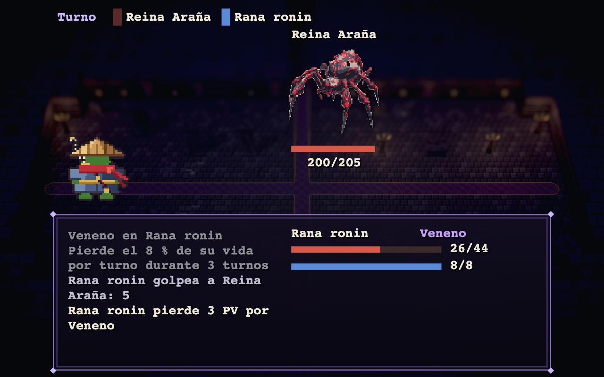 | 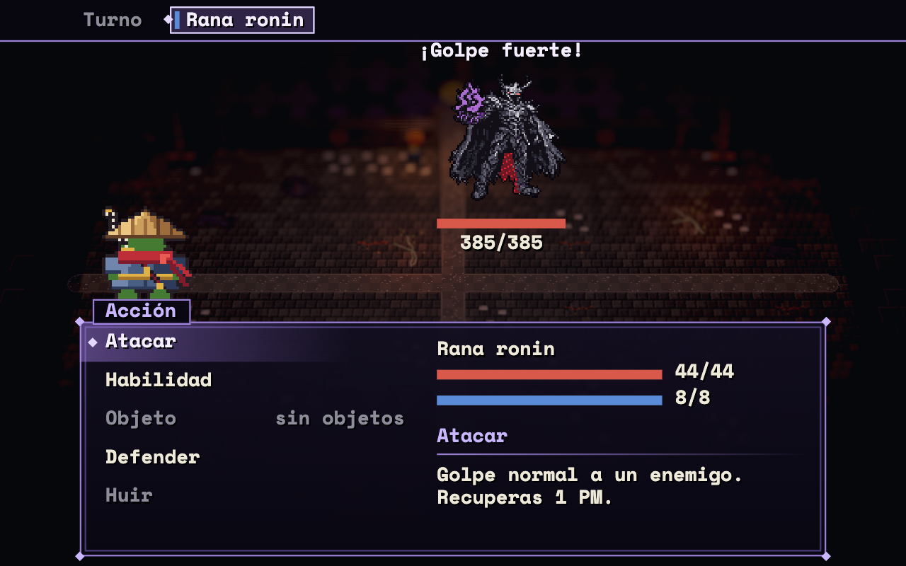 |

### Qué hay en una partida

- **Dos heroínas que se juegan distinto:** la ronin golpea fuerte y recupera maná atacando; la maga lanza fuego morado y se cura con hechizos. Tres dificultades, cada una con sus récords.
- **Monstruos que te ven:** patrullan la sala, un «¡!» avisa cuando te descubren y, si los pillas por la espalda, atacas primero.
- **Progresión:** cada nivel da puntos para repartir; el equipo sale de los cofres y del botín, y la heroína lo lleva puesto.
- **Variedad entre partidas:** presagios por zona (luna roja, manada, fuente seca, coraza), salas violetas con un jefe opcional, un cofre que muerde y salas de evento: un altar que cambia vida o magia por experiencia, un desafío de tres combates seguidos, un ermitaño que comparte sus provisiones y un puesto donde cambiar el equipo que sobra por pociones.
- **Reto del día:** el Bosque en corto, con el mismo mapa para todo el mundo durante el día y un récord por rana. Se puede quitar de la portada en Controles o en Ajustes.
- **Bestiario y logros**, y la partida se guarda al entrar en cada sala por si se cierra el navegador (sin trampas: un combate a medias se repite desde el principio).

| Elige heroína | Inventario | Bestiario |
| --- | --- | --- |
| 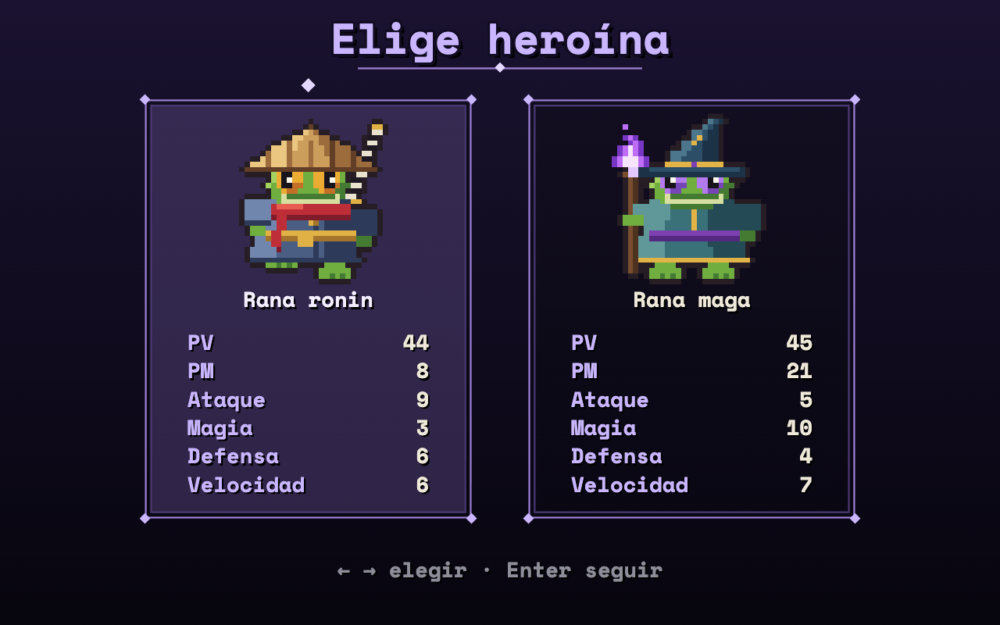 | 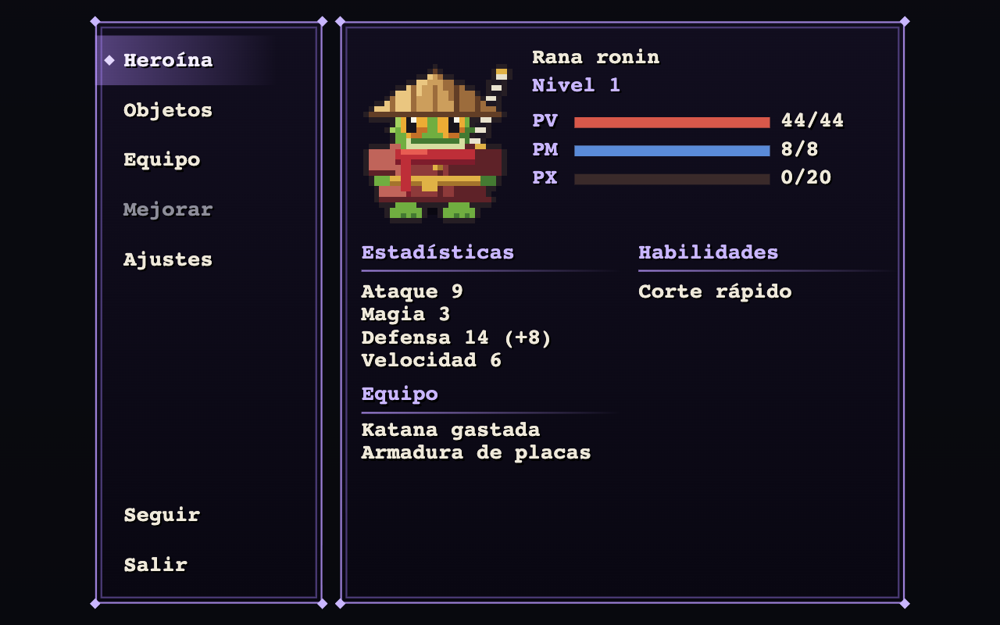 | 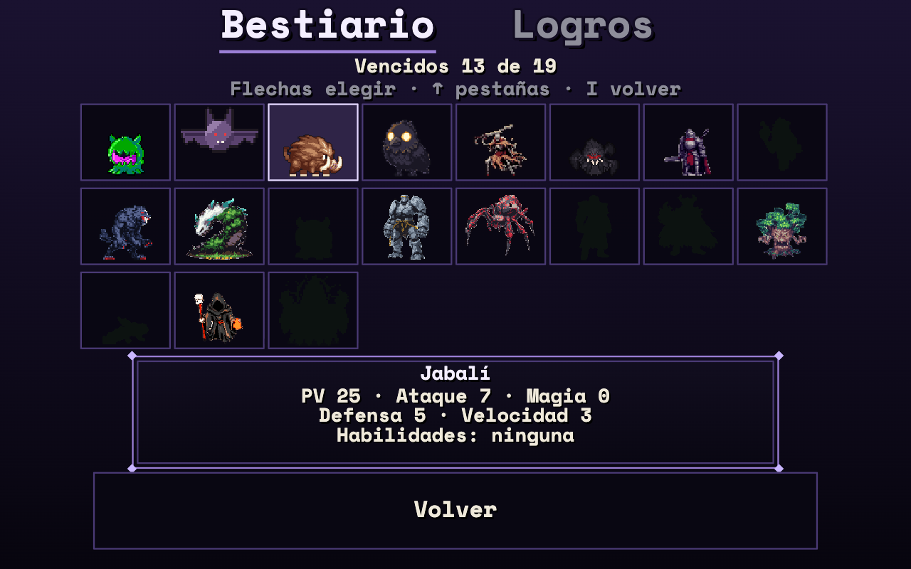 |
| **Salas de evento** | **Reto del día** | |
| 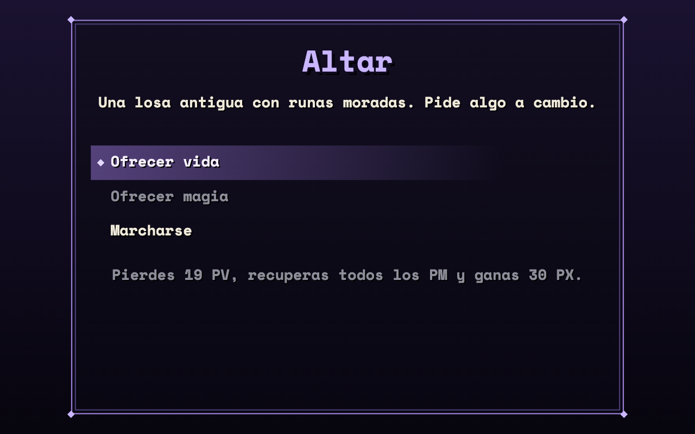 |  | |

### En el móvil

De pie, la cámara sigue a la heroína, el combate se apila en una columna y los menús van en pestañas.

<p>
  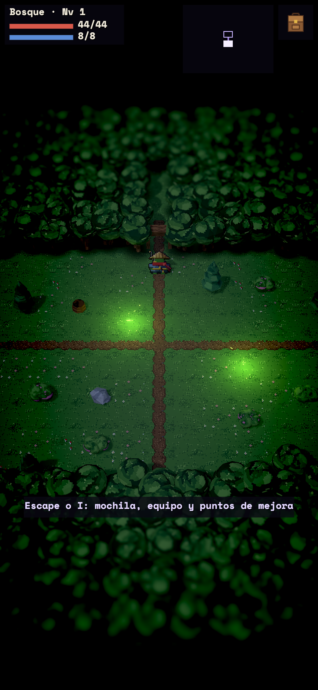
  &nbsp;
  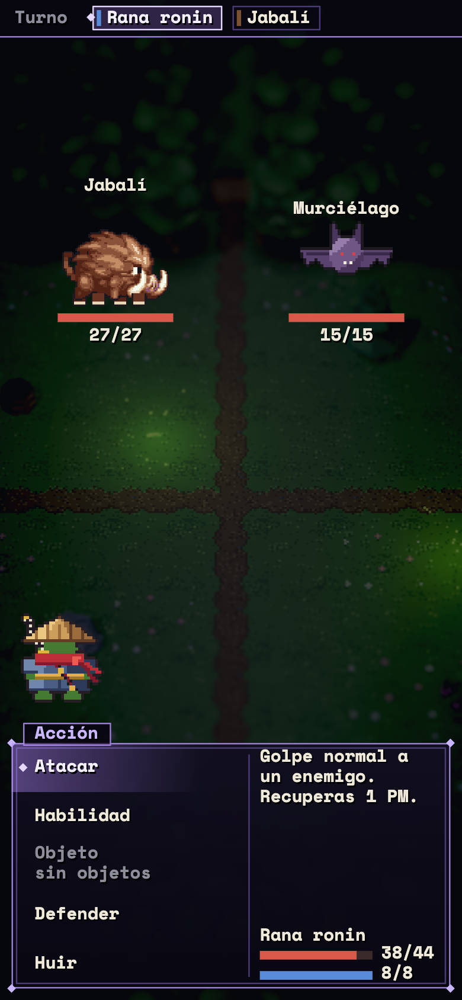
</p>

## Controles

| Acción | Teclado | Táctil | Mando (Xbox) |
| --- | --- | --- | --- |
| Moverse y elegir | Flechas o WASD | Joystick (arrastra en cualquier punto) | Stick o cruceta |
| Correr | Mantén Mayúsculas | Lleva el dedo al borde del joystick | X o gatillo derecho |
| Aceptar | Enter, Espacio o Z | Toca la opción | A |
| Volver | Escape o X | La opción «Volver» de cada pantalla | B |
| Inventario (pausa) | Escape o I | Botón de la mochila | Menú |
| Usar una habilidad, un objeto o elegir enemigo | Enter | Dos toques: el primero enseña qué hace, el segundo lo usa | A |
| Bestiario y logros (en la portada) | I | Botón de arriba a la derecha | Y |

Las pistas en pantalla cambian solas según lo último que hayas usado. El mando vibra con los golpes; el temblor de la pantalla y la vibración se regulan en Ajustes.

## Por dentro

- **Sin motor.** TypeScript `strict` y Vite. Bucle con lógica a 60 Hz fijos y dibujado interpolado; escenas en una pila (el combate se apila sobre el mapa). La interfaz y el combate se dibujan a mano en Canvas 2D.
- **HD-2D con Three.js.** El mapa, la portada y el fondo del combate son escenas 3D en un canvas WebGL bajo el 2D: sprites de pie, muros y objetos con relieve, agua hundida, sombras, luces que parpadean, tilt-shift, bloom y niebla. Lo que tapa a la heroína se vuelve transparente con un tramado en el shader. Todos los números del aspecto viven en [hd2d.json](src/data/hd2d.json).
- **Pixel art que recibe luz.** De cada hoja de sprites se saca un mapa de normales, así que la hoguera recorta a las ranas y a los monstruos como un contraluz ([relieve.ts](src/core/relieve.ts)).
- **Golpes con peso.** Cada golpe tiene un peso (leve, fuerte o máximo) que decide el temblor, la pausa de impacto, el destello, el tamaño del número y la vibración del mando; la cámara del combate se acerca al atacante ([impacto.ts](src/core/impacto.ts)).
- **Lógica pura y testeada.** `src/core/` no toca el navegador. El combate es una máquina de estados que emite eventos y la escena solo los anima. Unos 650 tests de Vitest cubren generación de zonas, combate, IA, jefes, progresión, guardado, presagios, eventos, el reto del día, el mando y los logros.
- **Datos, no números en el código.** Estadísticas, monstruos, zonas, botín, historia, ritmo de las animaciones, música y aspecto 3D de cada zona están en los 19 JSON de [src/data/](src/data/). Lo que distingue a las heroínas vive en [heroes.json](src/data/heroes.json), sin `if` por heroína en la lógica.
- **Equilibrado medido.** Una jugadora simulada ([jugadora.ts](src/core/jugadora.ts)) juega cientos de partidas enteras con cada heroína en cada dificultad, y los tests exigen que lleguen al final el 65-75 % en Fácil, el 45-55 % en Normal y el 25-35 % en Difícil, sin más de 5 puntos entre ellas ([equilibrado.test.ts](tests/equilibrado.test.ts)).
- **Un reto del día justo.** El mapa sale de la fecha y, antes de jugarlo, el propio juego lo prueba 100 veces con cada rana; si alguna gana menos del 55 % o más del 75 %, pasa a la semilla siguiente. Tarda unos 60 ms y da el mismo mapa en todos los navegadores.
- **Arte generado por script.** Heroínas, efectos y tilesets salen de scripts deterministas en Python ([tools/generadores/](tools/generadores/)); la mayoría de los monstruos se reducen de ilustraciones de referencia, a doble resolución, y se repintan con la paleta del juego.
- **Sonido sintetizado.** Música por zona y efectos con Web Audio a partir de notas en JSON; no hay ningún archivo de audio.
- **Accesible.** Se juega entero con teclado o mando; lo que pasa en pantalla se lee en una región `aria-live` para lectores de pantalla, y respeta `prefers-reduced-motion`.
- **Ligero.** Unos 220 KB de código comprimido con Three.js incluido; con todo el arte, unos 3 MB.

## Desarrollo

```bash
npm install
npm run dev     # servidor de desarrollo
npm test        # tests (Vitest)
npm run lint    # ESLint y Prettier
npm run build   # tipos y build de producción en dist/
```

Cada push a `main` se publica en GitHub Pages con GitHub Actions. `?semilla=N` en la URL repite una partida.

```text
nenufar/
├── src/
│   ├── core/       # lógica pura: zonas, combate, IA, progresión, guardado, eventos, reto, jugadora simulada
│   ├── data/       # JSON de diseño: héroes, monstruos, zonas, objetos, historia, sonido, aspecto 3D, salas
│   ├── escenas/    # portada, mapa, combate, inventario, eventos, reto, bestiario… (pila de escenas)
│   ├── input/      # teclado, joystick, toque y mando como fuentes de acciones abstractas
│   └── render/     # canvas, sprites, HUD, sonido, accesibilidad y almacenamiento
│       └── mundo/  # el mapa en 3D con Three.js
├── public/assets/  # hojas de sprites y tilesets, cada una con su JSON
├── tests/          # Vitest, incluido el simulador de equilibrado
├── tools/generadores/  # scripts en Python que generan el arte
└── docs/           # capturas, diseños y planes de cada hito
```

<details>
<summary>Formato de los assets y cómo regenerar el arte</summary>

**Sprites** (`public/assets/sprites/`): cuadros con una fila por dirección (`down`, `left`, `right`, `up`) y animaciones por columnas. Las ranas son de 32×32 (`idle`, `walk`, `golpe`, `derrota` y su ataque, `atacar` o `cast`) con el ancla en los pies, en (16, 30); en la maga, `castReleaseFrame` marca cuándo sale la bola de fuego. Los monstruos llevan `idle`, `walk`, `atacar` y `golpe`; los que van a doble resolución declaran `scale: 2` y se ven del mismo tamaño que el resto.

**Tilesets** (`public/assets/tilesets/<zona>.json`): cada tile tiene `name`, `index`, `layer` (`suelo`, `muro`, `objeto` o `dosel`) y `solid`; `weight` en los suelos, `frames`/`fps` en los animados y `caja` (la base que choca) en los objetos sólidos. Los objetos altos se parten en `_sup` (dosel) e `_inf` (sólido) y se ordenan por la Y de su base junto con los personajes. Los **autotiles** tienen 16 variantes por tipo según los vecinos (`N=1, E=2, S=4, O=8`).

**Plantillas de sala** (`src/data/salas/plantillas_<zona>.json`): mapas ASCII de 21×13 con su `leyenda` y sus `autotiles`. Diseñar una sala nueva es añadir un mapa.

**Regenerar el arte:**

```bash
pip install -r tools/requirements.txt
python tools/generadores/generar_todo.py
```

Las semillas son fijas: sin cambios en los scripts, el resultado es idéntico píxel a píxel.

</details>

## Créditos

El arte sale de los scripts del repositorio y el sonido se sintetiza en el navegador. Más detalle en [CREDITS.md](CREDITS.md).

📄 [Documento de desarrollo](https://claude.ai/code/artifact/a6ea0dd0-438d-4190-8647-06fd62dc8754): el diseño completo y el registro de cada hito.
